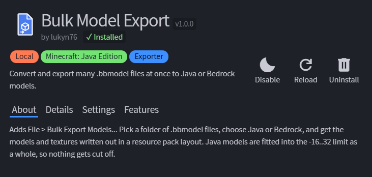

# Bulk Model Export

Blockbench plugin to export many `.bbmodel` files at once to Java (`.json`) or Bedrock (`.geo.json`) models.

- Exports every .bbmodel in a folder
- Converts from any Blockbench format
- Fits Java models into the size limit without cutting them
- Outputs models and textures in a resource pack layout

## Install

Put `bulk_export.js` and `icon.svg` in the same folder, then in Blockbench go to **File > Plugins > Load Plugin from File**.

## Usage

**File > Bulk Export Models...**

## License

[MIT](LICENSE)
